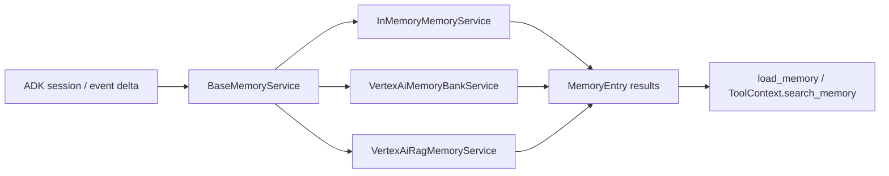

# Google ADK source review

**Review status:** Reviewed from code  
**Benchmark status:** Benchmark not run  
**Curated ordinal / name / slug:** 267 / Google ADK / `adk-python`  
**Listed repository locator:** [google/adk-python](https://github.com/google/adk-python)  
**Canonical upstream:** [google/adk-python](https://github.com/google/adk-python)  
**Default branch / reviewed head:** main / [9fd6b330e6cd5d02bd3604d8e8a31fced17b0286](https://github.com/google/adk-python/commit/9fd6b330e6cd5d02bd3604d8e8a31fced17b0286)  
**Review time:** 2026-11-25 21:32:16 UTC (2026-11-25 13:32:16 PST; America/Los_Angeles).

## Identity and review pin

The catalog lists Google ADK at ordinal 267, slug `adk-python`, with the explicit locator `https://github.com/google/adk-python`. The pinned Agent Memory Atlas entry is recorded only for roster attribution and locator context; it is not assessment evidence. The official GitHub repository API identifies `main` as the default branch and `9fd6b330e6cd5d02bd3604d8e8a31fced17b0286` as its full current head.[[catalog]][[atlas]][[repo]][[head]]

## Summary

Google ADK’s Python package defines a memory service interface and three backends: an in-process event store, Vertex AI Memory Bank, and Vertex AI RAG. The durable backends delegate generation or retrieval to managed Google services; behavior such as deletion and provenance differs by backend. No runtime or benchmark was executed.[[readme]][[docs]][[memory]][[bank]][[rag]]

## Who and what

The official README describes ADK as an open-source, code-first Python framework for building and deploying agents. Its memory package is a pluggable component of the agent runtime rather than a standalone memory database; applications choose and configure a service and decide when sessions or event deltas are ingested.[[readme]][[docs]][[base]]

## Architecture and data model

BaseMemoryService defines session ingestion, optional event-delta and direct-memory writes, and scoped search. MemoryEntry holds `google.genai.types.Content` plus optional id, author, timestamp, and custom metadata; search returns a list of entries.[[base]][[entry]]

The shipped implementations are InMemoryMemoryService, VertexAiMemoryBankService, and VertexAiRagMemoryService. The first keeps event records in process; Memory Bank delegates memory generation and semantic retrieval to Agent Platform; RAG uploads session text into a configured corpus and retrieves matching contexts.[[docs]][[memory]][[bank]][[rag]]

Session state is distinct from long-term memory. ADK exposes a `load_memory` tool that calls `ToolContext.search_memory`; an application or runner must connect the chosen service and arrange ingestion.[[docs]][[tool]][[base]]

## Write, update, delete, and retrieval

**Write and update.** InMemoryMemoryService replaces a stored session when adding a whole session, while `add_events_to_memory` appends unseen event IDs as a delta. Both discard entries without content; full-session ingestion also applies event rewinds.[[memory]][[base]]

Memory Bank session ingestion routes events through Vertex AI `ingest_events` by default, with an alternative `generate` path selected by certain custom metadata. The default ingest request runs as a background task and errors are logged; direct `add_memory` uses remote create calls or server-side consolidation. Ingestion includes event IDs and timestamps on the default path.[[bank]][[base]]

RAG serializes visible event text, author, and timestamp as JSON lines in a temporary file, then uploads it to the configured corpus under an encoded app/user/session display name. The base interface’s direct event and memory methods are optional and are not implemented by every service.[[rag]][[base]][[docs]]

**Delete.** In-memory `delete_memory` removes a matching event ID only within the supplied app/user scope and remembers that ID to suppress re-ingestion for the process lifetime. It is volatile and lost on restart. Memory Bank and RAG do not override the base `delete_memory`, whose default raises `NotImplementedError`; source inspection therefore found no delete operation in these backends, not a claim about operations available outside this package.[[memory]][[bank]][[rag]][[base]]

**Retrieval.** In-memory search scans visible event text, normalizes Unicode, and ranks by overlapping query-word count, returning up to ten entries. It is lexical rather than semantic. Memory Bank sends `app_name` and `user_id` as remote scope and requests similarity retrieval; it also exposes scope-keyed structured profile retrieval. RAG calls hosted vector retrieval, reconstructs matching events, and returns them as memory entries.[[memory]][[bank]][[rag]]

## Scope isolation

Base operations use `app_name` and `user_id`; in-memory storage is keyed by that pair, and Memory Bank forwards the pair as remote scope. RAG encodes the pair into uploaded-file display names, lists corpus files in pages of 100 up to ten pages, and narrows candidate resources when listing completes. If listing fails or exceeds that cap, it retrieves from the configured corpus and filters the returned contexts by the encoded pair. These are source-level controls; this review did not run cross-scope probes or establish deployment authorization behavior.[[base]][[memory]][[bank]][[rag]]

## Provenance and evidence

MemoryEntry can carry an id, author, timestamp, and arbitrary metadata. In-memory results retain event IDs, author, and timestamps. Memory Bank search results contain the returned fact and update time with custom metadata, while RAG stores author and time in its uploaded JSON lines. The API does not require source documents or citations, and RAG reconstruction does not preserve a stable event ID in the returned MemoryEntry. Evidence support and citation coverage are unmeasured.[[entry]][[memory]][[bank]][[rag]][[base]]

## Efficiency and observability

The in-memory backend uses a lock and scans its event records linearly, then sorts lexical matches and caps the response at ten. Memory Bank delegates extraction/retrieval to a managed API and triggers default ingestion asynchronously with task error logging. RAG performs corpus listing for scope narrowing and retrieval in the hosted service; its scope listing is capped at 1,000 files per configured corpus per search. These code paths do not establish observed latency, throughput, or cost.[[memory]][[bank]][[rag]]

## Metric-domain evidence

All project benchmark domains are **unmeasured here**. Source inspection is not a benchmark result. The [metric definitions](../METRICS.md), [benchmark fixture](../fixtures/memory-benchmark-v1.json), and [execution status record](../results/initial-baselines-status.json) define project evaluation materials, not Google ADK results.[[metrics]][[fixture]][[status]]

| Domain | Source evidence | Measurement status |
|---|---|---|
| Answerable retrieval and abstention | In-memory has a bounded lexical ranker; Vertex backends use hosted retrieval. | Unmeasured |
| Correction and stale values | The shared contract has no correction/update operation; correction behavior was not evaluated. | Unmeasured |
| Deletion leakage | Local deletion suppresses event re-ingestion in process; managed backends lack a package-level delete override. | Unmeasured |
| Scope isolation | Implementations carry app/user keys and RAG filters results; no isolation workload ran. | Unmeasured |
| Evidence support and citations | Records can carry author/time/metadata; source citations are not required. | Unmeasured |
| Latency and write-to-recall delay | Ingestion may run asynchronously; no timed probes were collected. | Unmeasured |
| Tokens and cost | Usage and price accounting were not collected. | Unmeasured |
| Storage efficiency | Local state is volatile and managed storage is external; attributable bytes were not measured. | Unmeasured |

## Limits and unknowns

This bounded review inspected selected memory API, backend, tool, and official documentation at the verified repository head. ADK, its tests, external Google services, and benchmark workloads were not run. Managed service behavior, retention, deletion propagation, billing, availability, and latency depend on deployed resources and configuration that were not exercised. A code path carrying scope keys is not itself a measured isolation guarantee.[[readme]][[base]][[memory]][[bank]][[rag]][[docs]]

The review did not inspect every agent/session integration or managed-service API behavior. It cannot establish retrieval quality, ingestion completion time, effective deletion, cost, or storage efficiency.[[base]][[bank]][[rag]][[metrics]]

## Benchmark status

**Benchmark not run.** No Google ADK runtime, tests, managed service calls, or benchmark workload was executed. The [project metric definitions](../METRICS.md), [benchmark fixture](../fixtures/memory-benchmark-v1.json), and [execution status record](../results/initial-baselines-status.json) describe protocol and status, not Google ADK measurements.[[metrics]][[fixture]][[status]]

## Contact

The official pinned repository README was checked for a published contact email. None was found; the structured record stores `contact_email: null` with the exact checked URL. No address was inferred from commit/profile metadata, package metadata, or a third-party directory.[[readme]]

## Sources

All upstream file citations are pinned to the verified full SHA. The Atlas source records curated roster attribution only and is excluded from assessment evidence. See the structured record [adk-python.json](../data/system-reviews/adk-python.json) and [curated roster](../data/memory-systems.json).
