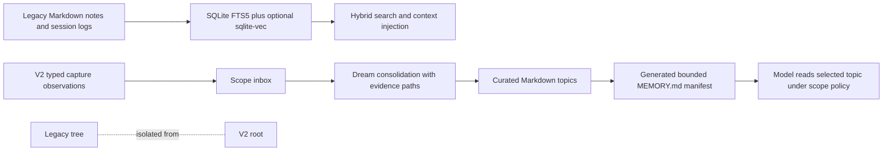

# Grok Build source review

**Review status:** Reviewed from code  
**Benchmark status:** Benchmark not run  
**Curated ordinal / name / slug:** 276 / Grok Build / `grok-build`  
**Listed repository locator:** [xai-org/grok-build](https://github.com/xai-org/grok-build)  
**Canonical upstream:** [xai-org/grok-build](https://github.com/xai-org/grok-build)  
**Default branch / reviewed head:** main / [2bdd1d6a6369de0e8c68132ea4539e9abd9e14a8](https://github.com/xai-org/grok-build/commit/2bdd1d6a6369de0e8c68132ea4539e9abd9e14a8)  
**Review time:** 2026-11-25 22:05:05 UTC (2026-11-25 14:05:05 PST; America/Los_Angeles).

## Identity and review pin

The curated roster lists Grok Build at ordinal 276, slug `grok-build`, with the explicit locator `https://github.com/xai-org/grok-build`. The pinned Atlas entry is recorded only for roster identity and locator attribution; it is not assessment evidence. The official GitHub repository API identifies `main` as the default branch, and its current main commit API returns full head `2bdd1d6a6369de0e8c68132ea4539e9abd9e14a8`.[[catalog]][[atlas]][[repo]][[head]]

## Summary

Grok Build is a Rust coding-agent CLI/TUI with cross-session memory. The inspected head contains two distinct memory pipelines: legacy Markdown notes and session logs with a SQLite hybrid-search index, and an opt-in v2 topic/observation pipeline with scoped access, durable capture, Dream consolidation, a generated manifest, and tombstone-based forgetting. The user guide calls memory experimental and disabled by default. No runtime, tests, or benchmarks were run.[[readme]][[guide]][[lib]][[storage]]

## Who and what

The official README describes Grok Build as SpaceXAI's terminal coding-agent harness and TUI, with interactive, headless, and Agent Client Protocol entry points. It says the public repository is periodically synced from the monorepo, so this review describes the public snapshot at its verified GitHub head rather than claiming that it exactly matches a live product release.[[readme]][[docs]][[repo]][[head]]

## Architecture and data model

Legacy storage places global `MEMORY.md` and per-workspace `MEMORY.md` plus dated session logs below `~/.grok/memory/`. V2 uses a separate `~/.grok/memory-v2/` root with global and workspace scopes; its module documentation says v2 never reads or writes the legacy tree.[[guide]][[lib]][[storage]]

The v2 scope foundation contains topic files, an observation inbox, an archive, a generated `MEMORY.md` manifest, a durable SQLite state database, and a lexical index. The manifest has byte and entry budgets and points to topic files rather than embedding every topic body.[[v2]][[guide]]

Legacy index rows represent text chunks with path, line range, source, content hash, creation time, and access count. SQLite FTS5 is always used. Optional sqlite-vec provides vector KNN, and the implementation can fall back to lexical-only retrieval.[[index]][[search]][[lib]]

Grok exposes memory through session integration, first-turn context injection, `memory_search` and `memory_get` tools, the `/memory` browser, `/remember`, `/flush`, `/dream`, and CLI clearing. Memory initialization is feature-gated; the user guide documents memory as experimental and disabled by default.[[guide]][[lib]]

## Write, update, delete, and retrieval

**Legacy writes and updates.** Session-end metadata summaries are written without an LLM call; `/flush` asks a model to summarize the current session into a dated log. `/remember` writes an approved durable statement to global or workspace `MEMORY.md`. Dream consolidates session logs and notes into organized memory. Direct file edits are reindexed by a watcher on search. The guide describes `forget` as best effort and recommends directly editing or deleting files for guaranteed removal.[[guide]][[storage]][[index]]

**V2 writes and updates.** Capture persists bounded, typed observations with session and turn-range metadata, job identity, ordinal/count, and content hashes. It publishes files before outcome rows, and recovery reconciles only complete hash-consistent file sets. Dream claims an inbox snapshot under a lease, does model work outside transactions, then commits replayable topic create, update, delete, rename, merge, or split operations with evidence paths.[[capture]][[consolidation]]

V2 model-visible writes are limited to Markdown files directly under `topics/` or `observations/_inbox/`. Replacing existing content requires an earlier ordinary read and unchanged content snapshot; observations are append-only. Writes use atomic replacement and refresh the generated manifest.[[access]][[v2]]

**Delete.** V2 forgetting names one path in one scope, supplies the BLAKE3 hash of content the caller inspected, and records a reason. A tombstone is committed before the file is removed, enabling reconciliation after a crash. Legacy forgetting and manual file deletion operate through different mechanisms, so the v2 tombstone behavior should not be attributed to legacy memory.[[maintenance]][[access]][[guide]]

**Retrieval.** Legacy search merges FTS5 and optional vector results, filters empty/scaffold chunks, applies temporal decay to session chunks, source weights and access-count boost, then optional maximal-marginal-relevance reranking and a result limit. If embeddings or vector support are unavailable, retrieval degrades to FTS-only. The guide describes first-turn injection, post-compaction searches, and explicit `memory_search`/`memory_get` tools.[[search]][[backend]][[index]][[guide]]

V2's generated manifest helps the model choose topic files. Model-visible reads pass through the v2 scope policy; a per-topic read ledger ranks compact-index entries by use. That counter is advisory: if recording fails or is busy, rendering and reads fall back to path order.[[guide]][[v2]][[access]][[reads]]

## Scope isolation

Global and workspace memory are separate. The guide says repository clones and worktrees share a workspace scope, while v2 has separate global and workspace roots. V2's access policy rejects traversal, symlinks, out-of-scope paths, nested unsupported paths, and writes to protected paths; overwriting a topic also requires a current read snapshot. These are source-level controls, not a measured tenant-isolation guarantee.[[guide]][[storage]][[access]]

V2's durable capture, state database, and topic operations require local shared-memory coordination; source code rejects network-mounted scope directories. Scope is local to the user's Grok home/workspace model, and no cross-user or hostile-host isolation workload was performed.[[v2]][[capture]][[consolidation]]

## Provenance and evidence

V2 capture preserves session identity, turn range, observation type, job metadata, and content hashes. Dream topic operations carry evidence paths, and the maintenance ledger records a hash-checked forget reason. These structures provide internal lineage inputs, but they do not guarantee that a generated answer will include citations or that a model's consolidated statement is fully supported by the source observation.[[capture]][[consolidation]][[maintenance]]

Legacy memory is stored as Markdown notes and session summaries. Search results include source and chunk metadata, but the inspected contract does not require answer-level source citations. The guide says memory product telemetry contains fixed enums, booleans, counts, and durations, not prompts, statements, topic names, keywords, paths, model output, or free-form errors.[[storage]][[index]][[guide]]

## Efficiency and observability

Legacy retrieval uses persistent SQLite indexing, FTS5, and optional vector KNN; it can degrade to FTS-only. Search applies bounded result counts, temporal decay only to session chunks, source weighting, access-frequency boosts, and optional MMR. V2 bounds manifest bytes/entries, file sizes, directory scans, capture counts, and recovery work; the per-topic read ledger uses a short busy timeout and degrades to path ordering.[[index]][[search]][[v2]][[capture]][[reads]]

The legacy memory archive includes session logs and global/workspace `MEMORY.md` files. Its builder skips symlinks and non-regular files and caps each file at 8 MiB; this is an archive-safety limit, not a storage-efficiency measurement.[[archive]]

The code documents logging and structured memory observations; the user guide describes privacy-limited product telemetry. These controls do not establish observed latency, throughput, resource use, or cost.[[backend]][[guide]]

## Metric-domain evidence

All project benchmark domains are **unmeasured here**. Source code and configuration defaults are not benchmark results. The [metric definitions](../METRICS.md), [benchmark fixture](../fixtures/memory-benchmark-v1.json), and [execution status record](../results/initial-baselines-status.json) describe project evaluation materials, not Grok Build measurements.[[metrics]][[fixture]][[status]]

| Domain | Source evidence | Measurement status |
|---|---|---|
| Answerable recall and abstention | Legacy has configurable lexical/hybrid ranking; v2 uses a bounded manifest and topic reads. | Unmeasured |
| Correction and stale values | Legacy notes can be edited; v2 has topic operations and session-age treatment. | Unmeasured |
| Deletion leakage | Legacy forget is best effort; v2 uses hash-checked tombstones. | Unmeasured |
| Scope isolation | Separate global/workspace roots and v2 path checks; no cross-scope probe ran. | Unmeasured |
| Evidence support and citations | V2 tracks observation metadata and evidence paths, without answer-citation guarantees. | Unmeasured |
| Retrieval latency and write-to-recall delay | Legacy flush/Dream and v2 capture/consolidation are separate paths; no timings collected. | Unmeasured |
| Tokens and cost | No token or price accounting collected. | Unmeasured |
| Storage efficiency | Markdown, SQLite, archive, and optional vector storage; no byte attribution measured. | Unmeasured |

## Limits and unknowns

The public repository README says the tree is periodically synced from a monorepo. This review is pinned to the verified public `main` head; the public snapshot may lag or differ from a product release.[[readme]][[repo]][[head]]

The user guide combines a newer v2 overview with extensive legacy workflows. This review used source modules to distinguish those implementations, but did not audit every host integration or rollout setting. Scope controls are source observations, not a tested guarantee against a malicious local process or host misconfiguration. The v2 code explicitly rejects network-mounted scope directories.[[guide]][[lib]][[access]][[capture]]

No Grok Build runtime, model-backed flush/Dream, tests, managed service calls, or benchmark workload was run. This inspection cannot establish recall quality, factual correction, deletion leakage, availability, latency, token usage, cost, or storage efficiency.[[search]][[maintenance]][[metrics]]

## Benchmark status

**Benchmark not run.** The [project metric definitions](../METRICS.md), [benchmark fixture](../fixtures/memory-benchmark-v1.json), and [execution status record](../results/initial-baselines-status.json) define protocol and shared execution status, not Grok Build results.[[metrics]][[fixture]][[status]]

## Contact

The official pinned repository README and `SECURITY.md` were checked for a published email; neither publishes one. The security policy directs vulnerability reports to HackerOne. The structured record stores `contact_email: null` and the exact checked URLs. No address was inferred from commit/profile metadata or third-party directories.[[readme]][[security]]

## Sources

All upstream file citations are pinned to the verified full SHA. The Atlas source is for curated roster attribution only and is excluded from assessment evidence. See the structured record [grok-build.json](../data/system-reviews/grok-build.json) and [curated roster](../data/memory-systems.json).
